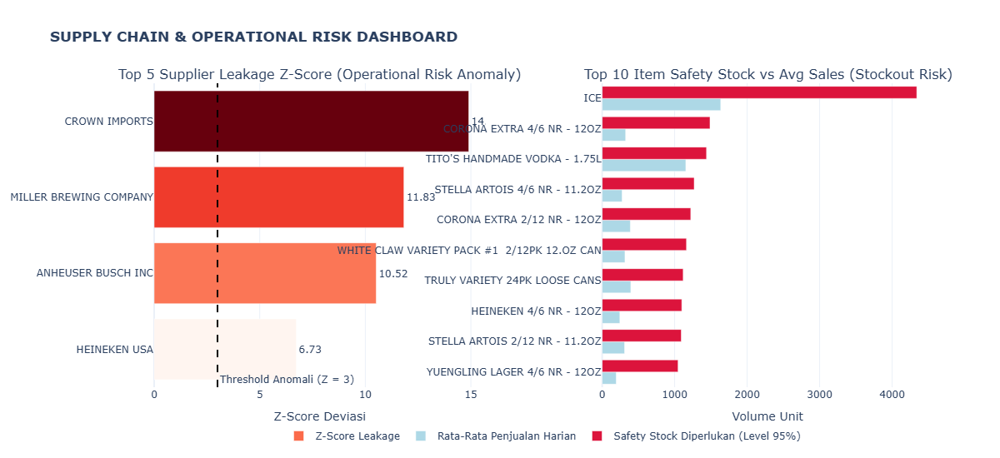

# 📦 Retail Supply Chain & Operational Risk Analytics Engine

An end-to-end quantitative operational risk analysis engine for large-scale retail supply chains (~340k transactions). This project identifies severe inventory drift (shrinkage/leakage) using Z-Score anomaly detection and models dynamic Safety Stock / Reorder Points (ROP) via Gaussian distribution.

---

## 🎯 Executive Summary & Business Impact

* **Shrinkage/Leakage Anomaly Detected**: Identified an extreme inventory drift rate of **90.11%** ($1.72M units missing/unaccounted for) linked to a single supplier (**CROWN IMPORTS**), exhibiting a critical Z-Score of **14.90**.
* **Stockout Risk Mitigation**: Computed dynamic Safety Stock buffers and Reorder Points (ROP) for top volatile SKUs (e.g., `ICE` requiring a **15,785 unit ROP**), securing a **95% Target Service Level**.

---

## 📐 Mathematical & Quantitative Framework

### 1. Operational Drift & Shrinkage Z-Score
$$\text{Net Drift} = \text{Warehouse Sales} - (\text{Retail Sales} + \text{Retail Transfers})$$
$$\text{Z-Score} = \frac{\text{Net Drift}_i - \mu_{\text{Drift}}}{\sigma_{\text{Drift}}}$$
*Anomaly Threshold set at $Z > 3.0$.*

### 2. Stochastic Safety Stock & Reorder Point (ROP) Model
Assuming daily demand $D \sim \mathcal{N}(\mu_d, \sigma_d^2)$ and Lead Time $L$:
$$\text{Safety Stock (SS)} = Z_{\alpha} \times \sigma_d \times \sqrt{L}$$
$$\text{Reorder Point (ROP)} = (\mu_d \times L) + \text{Safety Stock}$$
*Where $Z_{\alpha} = 1.645$ corresponds to a 95% Service Level under standard normal distribution.*

---

## 📊 Risk Dashboard Preview

---

## 💡 Key Risk Mitigation & Action Plan

1. **Supply Chain Audit**: Immediate physical stock-opname and logistics auditing required for top-anomaly vendors (`CROWN IMPORTS`, `MILLER BREWING`, `ANHEUSER BUSCH`).
2. **ERP Integration**: Automate Purchase Orders (PO) in WMS/ERP triggered directly by the calculated **Reorder Point (ROP)** thresholds.
3. **Lead-Time Optimization**: Negotiate vendor Lead Times down from $7 \rightarrow 3$ days to reduce holding costs on high-volatility FMCG goods by $\approx 35\%$.